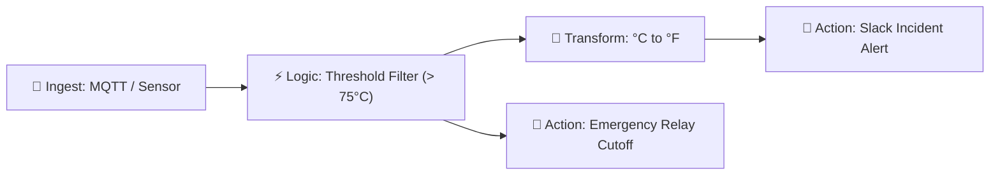

# NexusFlow - Visual IoT Telemetry Rule Engine

[](https://vitejs.dev/)
[](https://react.dev/)
[](https://reactflow.dev/)
[](https://www.typescriptlang.org/)
[](https://tailwindcss.com/)

**NexusFlow** is a modern, high-performance visual rule engine for IoT edge runtimes and cloud telemetry processing. It empowers engineers to design, simulate, and deploy real-time stream processing rules without writing complex streaming boilerplate.

---

## 🌟 Key Features

- **Interactive Canvas Workflow**: Node-graph canvas powered by `@xyflow/react` with custom port handles, live status glow badges, and animated telemetry links.
- **Node Palette**:
  - 📥 **Ingest Nodes**: MQTT Brokers, REST Webhooks, Synthetic Sensor Stream Simulators.
  - ⚡ **Logic & Filter Nodes**: Threshold Comparators, Safe Operating Band / Range Checkers, Anomaly Z-Score Outliers.
  - 🔄 **Transformation Nodes**: Unit Converters (°C/°F, W/kW), JSON Path Mappers, Calibrations.
  - 🚀 **Action Sinks**: Emergency Slack/PagerDuty Alerts, Actuator Down-link Relays, Webhook Dispatchers.
- **Real-Time Telemetry Simulation Engine**: Built-in event loop ticker simulating live device telemetry (temperature, vibration, power draw) with interactive threshold breach spikes.
- **Live Diagnostics Console**: Integrated bottom drawer logging rule evaluation outcomes, packet payloads, and action dispatch confirmations in real time.
- **Rule Inspector Drawer**: Click on any canvas node to configure rule conditions, thresholds, broker topics, or alert targets dynamically.
- **Import / Export**: Save and load workflow pipelines directly as JSON configurations.

---

## 🏗️ Architecture & Pipeline Flow



---

## 🚀 Quick Start

### 1. Prerequisites
- Node.js `>= 18.0.0`
- npm `>= 9.0.0`

### 2. Installation
```bash
git clone https://github.com/miteshsawant01/NexusFlow-Visual-IoT-Telemetry-Rule-Engine.git
cd NexusFlow-Visual-IoT-Telemetry-Rule-Engine
npm install
```

### 3. Development Servers

#### Frontend (Visual Rule Engine)
```bash
npm run dev
```
Open your browser at `http://localhost:5173`.

#### Backend (High-Speed Time-Series Ingestion Server)
```bash
# Start MongoDB (via Docker or local service)
docker compose up -d

# Start Express Ingestion Engine
npm run server
```
Server listens at `http://localhost:5000`.

#### Run Ingestion Load Simulator (Benchmark)
```bash
npm run test:ingest
```

### 4. Build for Production
```bash
npm run build
```

---

## ⚡ High-Speed MongoDB Time Series Backend

NexusFlow includes a native MongoDB Time Series ingestion backend optimized for high-throughput IoT hardware telemetry:

- **MongoDB Time Series Collection (`hardware_telemetry`)**:
  - `timeField`: `"timestamp"`
  - `metaField`: `"metadata"` (`deviceId`, `deviceType`, `facilityId`, `location`, `tags`)
  - `granularity`: `"seconds"`
  - Automatic TTL retention (default: 90 days)
  - Secondary compound indexes: `{ "metadata.deviceId": 1, timestamp: -1 }`

### Endpoints:
- `POST /api/v1/telemetry`: Single reading ingest with in-memory micro-batching buffer (50ms window / 500 records max).
- `POST /api/v1/telemetry/batch`: Bulk ingest endpoint using unordered `insertMany` (`{ ordered: false }`) for industrial edge gateways.
- `GET /api/v1/telemetry/latest/:deviceId`: Instant lookup of most recent sensor packet.
- `GET /api/v1/telemetry/query`: Dynamic time-range queries with `$dateTrunc` downsampling (`1s`, `1m`, `5m`, `1h`).
- `GET /api/v1/telemetry/stats`: Live ingestion pipeline metrics (throughput, queue size, processed batches).
- `GET /health`: Server health check.

---

## 🛠️ Tech Stack

- **Framework**: React 18 + Vite 6
- **Language**: TypeScript 5
- **Canvas / Flow Engine**: `@xyflow/react` (React Flow v12)
- **Styling**: Tailwind CSS, PostCSS, Autoprefixer
- **Icons**: Lucide Icons
- **Simulation**: Synthetic IoT Packet Evaluator with EventEmitter state model

---

## 📄 License
MIT License.
